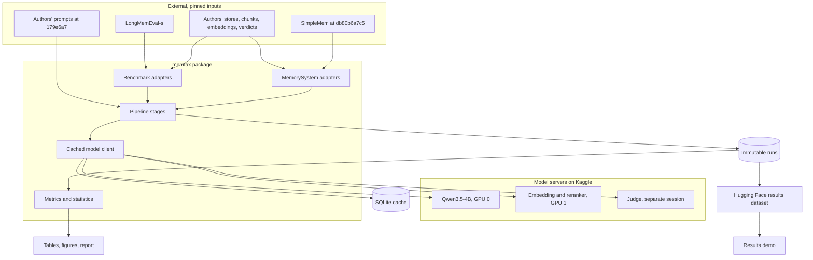

# Architecture

This is the shape of the system, so nobody has to re-derive it each session. Call-level detail is in [FLOW.md](FLOW.md).

## System map



## Modules

Built in Phase 0: `schema.py` (`Question`, `Turn`, `Verdict` only), `data.py` (question and verdict loaders), `metrics.py`, and `cli.py` (`audit`, `smoke`). Everything else in this table is planned ([D-024](DECISION.md)).

| Module | Responsibility | Must not |
| --- | --- | --- |
| `schema.py` | Shared records: `Question`, `Retrieved`, `Answer`, `Verdict`, `Manifest` | Import other project modules |
| `data.py` | `Benchmark` protocol; LongMemEval and medication adapters | Know about memory systems |
| `chunking.py` | Appendix A.2 chunking rules | Call models |
| `llm.py` | Async chat, embedding, and rerank clients; cache; token accounting | Know about stages |
| `retrieval.py` | BM25, dense search, union, rerank | Know how answers are produced |
| `systems/base.py` | `MemorySystem` protocol: `build`, `retrieve` | Contain logic |
| `systems/rag.py` | One-round and two-round RAG | Touch stores |
| `systems/simplemem.py` | Live and replay modes | Modify upstream code |
| `systems/src_aug.py` | Pool, jointly rerank, and fill a token budget | Choose a budget on held-out data |
| `answer.py` | Renders context with the shared prompts | Vary prompts by system |
| `judge.py` | Runs the authors' judge prompts and parses verdicts | See the system's name |
| `metrics.py` | Pure functions over verdicts: tax, benefit, CIs, tests | Call models or read config |
| `pipeline.py` | Runs stages, resumes, shards, writes manifests | Contain research logic |
| `cli.py` | Command-line entry point | Contain logic |
| `extension/medmem/` | Generates and checks the medication benchmark | Depend on pipeline internals |
| `tests/fake_server.py` | Stands in for model servers in CI | Ship in the package |

## Repo layout

```text
memory-tax-replication/
├── CLAUDE.md, IMPLEMENTATION_PLAN.md, and the other project documents
├── pyproject.toml, uv.lock, .pre-commit-config.yaml; Makefile and THIRD_PARTY.md in Phase 5
├── .github/workflows/ci.yml
├── configs/          base, fixture, one per experiment; serve.lock pins server versions
├── vendor/memorytax/ authors' prompts at 179e6a7, with LICENSE and HASHES.sha256
├── src/memtax/       the modules below
├── extension/medmem/ medication benchmark
├── scripts/          plan_numbers.py, check_repo.py, kaggle_serve.sh
├── notebooks/        thin Kaggle runner; no logic lives here
├── tests/            unit tests, fixtures, fake_server.py
├── reports/          generated tables and figures, and the report
└── data/, runs/      not committed
```

## Stages and data

| Stage | Reads | Writes | GPU? |
| --- | --- | --- | --- |
| `prepare` | Pinned downloads | `data/` | No |
| `index` | Chunks | Per-history BM25 and `.npz` files | Only if embedding |
| `retrieve` | Index or stores | `retrieval.jsonl` | Reranker |
| `answer` | Retrieval, prompts | `answers.jsonl` | Yes |
| `judge` | Answers, gold answers | `verdicts.jsonl` | Yes |
| `metrics` | Verdicts of paired runs | `metrics.json`, tables | No |

```text
runs/<run_id>/            run_id = short hash of the full resolved config
  manifest.json           commit, config, model and dataset revisions, start and end
  config.yaml             the resolved config
  retrieval.jsonl         one record per question
  answers.jsonl
  verdicts.jsonl
  metrics.json
```

## Rules that hold everywhere

- `question_id` is the join key across all stages and runs.
- Finished runs are immutable. A different config gets a different `run_id`.
- Every model call passes through `llm.py`, so all calls are cached and counted.
- All systems answer through the same prompt, so differences come from retrieval and memory.
- Paired metrics require matching question sets and matching `judge_id`.
- `metrics.py` has no model or network access, so all tables rebuild without a GPU.

## Where to extend

| To add... | Do this | Change nothing in |
| --- | --- | --- |
| A memory system | New `systems/<name>.py`, plus a config | `metrics.py`, `judge.py` |
| A benchmark | New adapter in `data.py`, plus a judge prompt choice | `systems/` |
| A model | A config entry | Code |
| Longer runs | `--shard i/n` | Code |

## Environment

| Place | Runs | Persistence |
| --- | --- | --- |
| Laptop or CI | Tests, fixtures, metrics, reports | Git |
| Kaggle T4 x2 | Model serving, stages | Session only, so upload checkpoints |
| Hugging Face private dataset | Runs and cache checkpoints | Durable; versioned |
| Hugging Face public | Final results and demo | Durable; published in Phase 5 |
